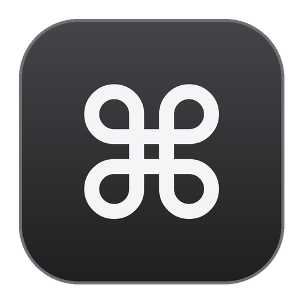

# chord

[](LICENSE)
[](#install)
[](https://github.com/ttncode/chord/releases)

Keyboard chords for Windows. Hold **Caps Lock**, hold **Space**, type a few letters, release Space: the matching action runs in the app in front. Chords live in plain TOML files, per app.

- **Shortcuts you don't have to remember:** a panel lists the chords for the app in front and narrows as you type.
- **Mouse-free:** switch apps, snap windows, scroll, and click any button through Vimium-style labels.
- **Small and fast:** one native Rust program, no runtime, no background service.

Inspired by [KeyChord/Chord](https://github.com/KeyChord/Chord) for macOS. This is an independent implementation; no code is shared. Early version: Windows only, tested on Windows 10 22H2.

## Install

1. Download `chord-setup-<version>.exe` from [Releases](https://github.com/ttncode/chord/releases/latest) and run it. It installs for your user only (no admin prompt) into `%LOCALAPPDATA%\Programs\chord`.
2. Keep **Start chord when I sign in to Windows** ticked, and finish with **Launch chord now**. A ⌘ icon appears in the notification area of the taskbar; there is no window.
3. Your chord files live in `%APPDATA%\chord\chords`. The first start creates them from the starter set; tray icon → **Open chords folder** opens them.

Windows may show a SmartScreen warning, because the installer isn't signed: choose **More info → Run anyway**.

Quit with `Ctrl + Space + Esc` or the tray menu. Only one copy runs at a time. Installing a newer version closes the running one and keeps your chord files; tray icon → **Check for updates** downloads and installs the newest release for you. Uninstall from **Settings → Apps**; your chord files stay in `%APPDATA%\chord`.

**Portable:** `chord-v<version>-windows-x64.zip` holds `chord.exe` and a `chords` folder. Unzip it anywhere and run `chord.exe`; a `chords` folder in the folder it starts from wins over `%APPDATA%\chord\chords`.

## Quick start

Hold Caps Lock, then hold Space, type `/e`, release Space: a File Explorer window opens. Then try `;` in that window: blue labels appear on its buttons; type a label's letters and release Space to click it.

Inside chord mode:

| Key | Does |
|---|---|
| `Backspace` / `Shift+Backspace` | Delete the last letter / all letters |
| `Esc` | Clear the letters |
| `Caps Lock` | Run the typed chord and stay in chord mode; with nothing typed, run the last chord again (`/mj⇪⇪` scrolls down three times) |
| `Shift` + letter | Run the typed letters plus this letter, keep the typed letters (`t` then `Shift`+`t`,`s`,`p` runs `tt`, `ts`, `tp`) |
| Ctrl / Alt / Win + key | Passed to the app as a normal shortcut |

Caps Lock alone still toggles Caps Lock. Space alone still types a space.

## Chord files

Every `*.toml` file in the chords folder (see [Install](#install)) is loaded. Files are read again each time a chord fires, so a saved change applies to the next chord, without restarting.

```toml
name = "Antigravity"
app = "antigravity ide.exe"   # process name; leave out for chords that work in every app
# title = "nvim"              # optional: the window title must contain this

[chords]
gd = { name = "Go to definition", shortcut = "f12" }
ca = { name = "Collapse folders", palette = "Collapse Folders in Explorer" }
"/t" = { name = "Open Windows Terminal", shell = "wt" }
```

Each chord has a `name` and exactly one action:

| Action | What it does | Example |
|---|---|---|
| `shortcut` | Presses keys. Combos joined with `+`; several combos separated by spaces run one after another | `"ctrl+shift+p"`, `"ctrl+k ctrl+0"`, `"space f f"`. Media keys: `volumeup`, `volumedown`, `volumemute`, `playpause`, `nexttrack`, `prevtrack`, `printscreen` |
| `palette` | Opens the command palette (`Ctrl+Shift+P`), waits 0.4 s, types the text, presses Enter. If the palette opens slower, the text lands in your file: use a `shortcut` where one exists | `"Collapse Folders in Explorer"` |
| `focus` | Brings the app's window to the front (its next window when it's already in front). Optional `launch` runs when it isn't open | `focus = "windowsterminal.exe", launch = "wt"` |
| `mouse` | `click`, `right-click`, `double-click`, `middle-click`, `scroll-up`, `scroll-down`, `scroll-left`, `scroll-right`, `back`, `forward` at the pointer | `mouse = "click"` |
| `hints` | Blue labels on every clickable element of the window; type a label, release Space, it's clicked (`click`, `right-click`, `double-click`) | `hints = "click"` |
| `shell` | Runs the command exactly as written (`cmd /S /C "…"`), without a console window | `'start "" "C:\path\app.exe"'` |

Key names: `ctrl shift alt win`, `a`–`z`, `0`–`9`, `f1`–`f24`, `left right up down home end pageup pagedown insert delete`, `backspace enter esc tab space`, and `` ` - = [ ] \ ; ' , . / ``. Write `+` as `plus`.

Chord letters: `a`–`z`, `0`–`9` and `` ; = , - . / [ ] ' ``. Start global chords with a symbol (`/e`) so they never clash with app chords.

**Groups:** an optional `[groups]` table names chord prefixes, e.g. `"/w" = "Window"`. While you type, the panel lists the groups that start with your letters on one line under the chords (type `/` to see every global group). A group in an app's file beats a global one with the same prefix.

**Regex chords:** parts in `( )` are a regular expression, the rest is literal; `$1`…`$9` in `name`, `shell` and `palette` are filled from the match. Example: `'/o(\d+)' = { name = "Open port $1", shell = 'start http://localhost:$1' }`, then type `/o3000`. An exact chord beats a pattern.

**Which chord wins** when several files define it: a file matching the app *and* window title, then the app only, then a global file with a title, then a plain global file. If two files tie, the one whose file name sorts first wins and the console prints a warning.

**Finding an app's name:** run a chord that doesn't exist (e.g. `zz`) in that app. The console prints `no chord 'zz' for <process name> "<window title>"`.

**Mistakes** in a file are printed at startup and with each chord: a bad chord is skipped, a file that isn't valid TOML is skipped, everything else keeps working.

## Starter chords

| File | Chords |
|---|---|
| `global.toml` | Apps: `/a` Antigravity · `/t` Terminal · `/c` Chrome · `/f` Firefox · `/p` Postman · `/b` Bruno · `/q` DBX · `/k` Mattermost · `/o` Outlook · `/g` Everything · `/=` Notepad++ · `/e` new File Explorer. Window (via `window.ahk`): `/wh` `/wl` `/wk` `/wj` halves · `/wf` maximize · `/wc` center · `/w1` `/w2` `/w3` thirds · `/wn` minimize · `/wq` close. Desktops: `/dh` `/dl` `/dn` `/dx`. System: `/ss` screenshot · `/sv` clipboard · `/se` emoji · `/sl` lock · `/st` Task Manager · `/si` `/sw` `/sb` `/sd` `/sk` Settings pages · `/sn` notifications · `/sr` Run · `/sx` power menu · `/r` DeepL. Media: `/vj` `/vk` volume · `/vm` mute · `/vp` play · `/vh` `/vl` tracks. Mouse: `/mc` `/mr` `/md` `/mm` clicks · `/mh` `/mj` `/mk` `/ml` scroll · `/mp` `/mn` back / forward · `/mt` `/mb` top / bottom. Labels: `;` click · `'` right-click |
| `antigravity.toml` | `mf` `me` `ms` `mv` `mg` `mr` `mt` `mh` menus (File, Edit, Selection, View, Go, Run, Terminal, Help) · `gd` go to definition · `gf` go to file · `cp` command palette · `fe` focus Explorer · `ts` toggle sidebar · `ca` collapse folders · `tt` toggle terminal · `fs` search in files · `fg` source control · `fd` focus editor |
| `windows-terminal.toml` | `nt` new tab · `cx` close pane · `tn` / `tp` next / previous tab (set the tab switcher to "In order") · `sv` / `sh` split right / down |
| `lazyvim.toml` | `fe` explorer · `ff` find files · `fg` grep · `bd` delete buffer (Normal mode) |

LazyVim chords need Neovim to put "nvim" in the window title. Add this to your Neovim config (e.g. `lua/config/options.lua`):

```lua
vim.opt.title = true
```

## Hint labels

Type `;` in chord mode (keep Space held): blue labels appear on the buttons, links, tabs and fields of the window in front. Type a label's letters (the list narrows as you type), release Space, and that element is clicked. `Backspace` past the `;` hides the labels.

To click several things in a row, keep Space held: tap `Caps Lock` (or hold `Shift` on the label's last letter) to click and get fresh labels at once. A `Caps Lock` tap with nothing typed brings the labels back after a pick.

- Works through Windows UI Automation, so it covers most apps (Explorer, Settings, Antigravity, Chrome, Office). Custom-drawn apps and games may show few or no labels.
- In Chrome, Vimium's `f` is faster and more complete for web pages.
- Electron apps (Antigravity, Postman, Slack) build their accessibility tree only when first asked, so chord reads twice when the first read is empty.
- When a modal dialog is open, only its contents get labels.

If a button gets no label, run chord with `--debug-hints`, press `;` there, and read `hints-debug.txt` (in the folder chord runs from): it lists every element Windows reported, with its type, position and name.

## Options

| Option | Does |
|---|---|
| `--chords <folder>` | Load chord files from this folder (default: `chords` in the current folder if there is one, else `%APPDATA%\chord\chords`) |
| `--background` | Don't print to the terminal chord was started from (used by Start with Windows) |
| `--debug-hints` | Each label scan writes what Windows reported to `hints-debug.txt` |

## Look

The panel and labels follow macOS: rounded corners, a soft shadow, Apple's system colours, keycaps for the keys, short fade animations. They follow Windows' light or dark mode, and the animations turn off when Windows' "Animation effects" setting is off.

## Known limits

- Chords do nothing while an app running as administrator is in front, and nothing works on the lock screen or UAC prompts.
- While a Remote Desktop or VM window is in front, chord on this PC leaves Caps Lock to it: run chord on the remote PC for chords there.
- Custom-drawn apps and games may show few or no labels; Postman's ☰ menu and window buttons are among them.
- chord has no window of its own. Started from a terminal, it prints what each chord does there; don't select text in that terminal while chord runs, or Windows pauses its output (QuickEdit) until you press Esc.

## Build from source

Needs [Rust](https://rustup.rs) 1.85 or newer on Windows. Without Visual Studio Build Tools, the GNU toolchain works (`rustup override set stable-x86_64-pc-windows-gnu` in the project folder), but its `chord.exe` gets no icon: only the MSVC toolchain can embed it.

```powershell
git clone https://github.com/ttncode/chord
cd chord
cargo test            # logic tests, no keyboard needed
cargo run --release   # prints to this terminal; or: cargo run --release -- --chords D:\my-chords
```

Releases are built by [GitHub Actions](.github/workflows/release.yml) when a `v*` tag matching the version in `Cargo.toml` is pushed: tests, `chord.exe`, the installer ([Inno Setup](installer/chord.iss)), the portable zip and `SHA256SUMS.txt`.

<details>
<summary>Manual test checklist (run on a real machine; the automated tests can't press real keys)</summary>

Chords from files:
- [ ] In Antigravity: `mf` opens the File menu, `fe` focuses the Explorer, `ts` hides/shows the sidebar, `ca` collapses all folders.
- [ ] In Windows Terminal: `nt` opens a new tab, `sv` splits the pane.
- [ ] Anywhere: `/wh` snaps the window left, `/dl` switches to the next desktop, `/t` opens Windows Terminal.
- [ ] In Neovim (with `vim.opt.title = true`): `fe` opens the LazyVim explorer.
- [ ] Change a chord's `shortcut` in a file, save, and run it again: the new shortcut is used without restarting.
- [ ] Write `shorcut` (typo) in one chord: the console names that chord, and the other chords still work.

Install:
- [ ] The installer runs without an admin prompt, adds "chord" to the Start menu, and "Launch chord now" starts it with no window.
- [ ] With "Start chord when I sign in" ticked, chord is running after a sign-out and sign-in.
- [ ] Running the installer again while chord runs closes it, installs, and keeps the files in `%APPDATA%\chord\chords`.
- [ ] Uninstalling from Settings → Apps removes the program and the startup entry; `%APPDATA%\chord` stays.
- [ ] `cargo run --release` in a terminal still prints each chord there.

Panel and tray:
- [ ] Holding Caps Lock + Space fades the panel in near the top centre, without taking focus from the app; typing narrows it and colours the typed keys blue; releasing Space fades it out.
- [ ] Switching Windows between light and dark mode changes the panel, the tray icon (⌘) and the tray menu to match.
- [ ] Tray icon → "Open chords folder" opens the folder; "Start with Windows" toggles a check mark and survives a reboot; "Quit" exits.
- [ ] Tray icon → "Check for updates" says the version is the latest, or offers the newer one; accepting installs it silently and chord starts again on its own.
- [ ] Type `/` in chord mode: a small line under the chords lists `/w Window · /d Desktop · …`; typing `/w` hides it. `/th` and `/tl` move the tab in Chrome, Antigravity and Windows Terminal.
- [ ] Starting a second copy prints "chord is already running".

Chord mode keys:
- [ ] In Antigravity: `ts` then `Caps` toggles the sidebar and stays in chord mode; `Caps` again toggles it back.
- [ ] In Windows Terminal: `t` then `Shift`+`n` opens a new tab (`tn`… runs next tab) while the panel still shows `t`.

Windows and mouse:
- [ ] `/a` switches to Antigravity (starts it when closed); with two Antigravity windows, `/a` again switches to the other one.
- [ ] `/mc` clicks at the pointer, `/mj` scrolls down.

Hints:
- [ ] `;` in File Explorer shows labels on its buttons; typing one and releasing Space clicks it.
- [ ] Labels sit on the right elements at 125%/150% display scaling.
- [ ] `;` + label + `Caps Lock` clicks it and shows fresh labels; another `Caps Lock` with nothing typed shows labels again.

Robustness:
- [ ] After Win+L and unlocking, and after sleep, chords still work without restarting.

Caps Lock:
- [ ] Tapping Caps Lock alone still turns it on and off.
- [ ] After any chord, the Caps Lock light and the actual state match what they were before.
- [ ] Tapping Caps Lock or running chords as fast as you can never stops chord (the loop breaker trips only at 30 in 2 seconds).
- [ ] With a Remote Desktop (`mstsc`) window in front, Caps Lock toggles once, the PC stays responsive, and chords reach the chord running on the remote PC.

Vietnamese Telex (switch to it with `Win + Space`):
- [ ] Outside chord mode, `Vieejt Nam` still becomes `Việt Nam`.
- [ ] Chord `dd` produces no `đ` in the app.

Normal typing:
- [ ] Holding Space alone types spaces as usual.
- [ ] `Ctrl + Space + Esc` always quits.

</details>

## License

MIT, see [LICENSE](LICENSE).
