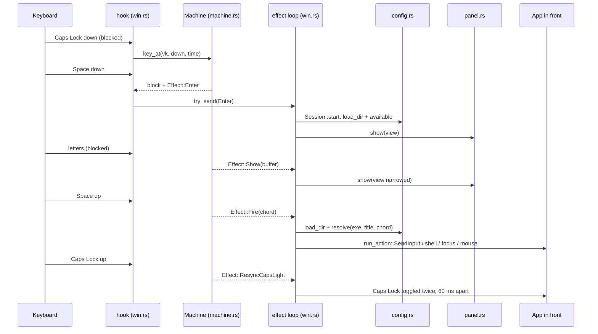

# Flow: chord press

Entrypoint: `src/win.rs:579`

| # | Step | Where |
| - | ---- | ----- |
| 1 | The hook skips events tagged with `TAG`, and Caps Lock that is injected or pressed while a remote desktop or VM window is in front; the rest goes to the machine, inside `catch_unwind` | `src/win.rs:583`, `src/config.rs:225` |
| 2 | The machine updates key state, recovers lost releases (1.5 s stale, 15 s idle), and returns block/pass plus an effect | `src/machine.rs:116` |
| 3 | The hook hands the effect over without blocking | `src/win.rs:602` |
| 4 | Caps Lock held + Space pressed enters chord mode | `src/machine.rs:169` |
| 5 | `Enter` reads the chord files once for the panel and shows it | `src/win.rs:322`, `src/win.rs:119` |
| 6 | Each letter sends `Show`; the panel narrows to matching chords | `src/win.rs:327`, `src/win.rs:127` |
| 7 | Space up sends `Fire` with the typed chord; a hint chord goes to the label flow instead | `src/machine.rs:242`, `src/win.rs:389` |
| 8 | `fire` re-reads the files and resolves the chord for the app and window title in front | `src/win.rs:457`, `src/config.rs:145` |
| 9 | The action runs with Shift lifted if held | `src/win.rs:473`, `src/win.rs:519` |
| 10 | Caps Lock up after a chord resyncs the Caps Lock light | `src/win.rs:646` |

## Failure modes

| When | Result | Handled at |
| --- | --- | --- |
| No chord matches | console: `no chord '<chord>' for <exe> "<title>"` | `src/win.rs:457` |
| A chord file has an error | bad chord or file skipped, error printed, others keep working | `src/config.rs:244` |
| Space or Caps release lost (focus change, UAC) | machine assumes it after 1.5 s or 15 s idle | `src/machine.rs:116` |
| Windows drops the hook (timeout, sleep) | reinstalled every 5 min and on unlock/resume | `src/win.rs:558`, `src/panel.rs:287` |
| A panic in the hook | key passes through unchanged | `src/win.rs:590` |
| Main thread busy, channel full (64) | effect dropped, hook stays alive | `src/win.rs:602` |
| Another program feeds chord's keys back (30 effects in 2 s) | hook passes every key, message names the app in front, chord exits | `src/win.rs:312`, `src/win.rs:630`, `src/machine.rs:297` |
