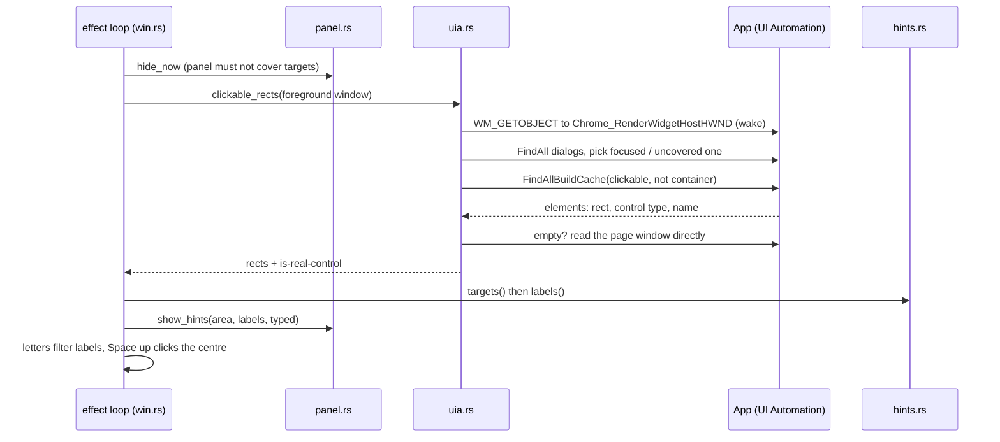

# Flow: hint labels

Entrypoint: `src/win.rs:561`

| # | Step | Where |
| - | ---- | ----- |
| 1 | Typing exactly a hint chord (`;`, `'`) opens labels; Caps repeat and Shift reopen them after a click | `src/win.rs:434`, `src/win.rs:464`, `src/config.rs:216` |
| 2 | The panel is hidden synchronously before the scan | `src/win.rs:561`, `src/panel.rs:166` |
| 3 | Up to 3 reads (0, 300, 600 ms) while Electron rebuilds its tree | `src/win.rs:257` |
| 4 | Chromium page windows get a wake-up `WM_GETOBJECT` | `src/uia.rs:330` |
| 5 | An open modal limits the scan: the focused one first, then one not covered at its centre | `src/uia.rs:163`, `src/uia.rs:372` |
| 6 | Elements whose centre is covered by another app's window are dropped (a child window of another process counts as the app's own: UWP content in ApplicationFrameHost) | `src/uia.rs:130` |
| 7 | An empty read falls back to the page window (Electron after a minimize) | `src/uia.rs:198` |
| 8 | Scroll bars and their arrows and track get no label. Parts of real controls and generic boxes around other clickables lose their label, except buttons (a tab's close button) and items nested in an open tree/list item (which is cut to its own row); of targets overlapping by half the smaller one or more, only the first keeps a label; cap 300 after filtering | `src/hints.rs:48` |
| 8b | `hints = "scroll"` reads scroll areas instead, in the raw view (Chromium leaves unnamed scroll `
`s out of the Control view): scroll pattern, scrollable; plus navigation landmarks, as Chromium can leave a sidebar's scroll box out of the tree, and main landmarks where no real scroll area overlaps them (ChatGPT's chat). Only areas ≥ 80 px a side showing < 95 % of their content count (Chromium calls 1 px of overflow scrollable); nested ones all keep a label; none found falls back to the clickable read. Each label sits at its area's `spot`, the point nearest its centre outside the areas nested in it, and a pick moves the pointer there | `src/uia.rs:241`, `src/hints.rs:111`, `src/hints.rs:148` |
| 8c | When a label would cover an earlier one's and the two elements overlap too (parts of one thing), only the first keeps a label; labels are then reassigned and checked again | `src/hints.rs:84`, `src/win.rs:304` |
| 9 | Prefix-free labels from `sadfjklewcmpgh` | `src/hints.rs:162` |
| 10 | Labels drawn at each element's top-left on a click-through overlay | `src/panel.rs:586` |
| 11 | Space up with a full label moves the pointer to the element centre and clicks | `src/win.rs:580`, `src/win.rs:334` |

## Failure modes

| When | Result | Handled at |
| --- | --- | --- |
| UI Automation errors (e.g. `0x80040201` in Chrome) | `could not read this window's buttons`, after 3 tries | `src/win.rs:257` |
| Nothing clickable reported | `no clickable elements found`; Space up says `no labels on screen to pick from` | `src/win.rs:257`, `src/win.rs:536` |
| Element exists only as pixels (custom-drawn, Postman's ☰ and window buttons) | no label; nothing to read | — |
| A closed dialog lingers in the tree | ignored unless something in it is clickable | `src/uia.rs:163` |
