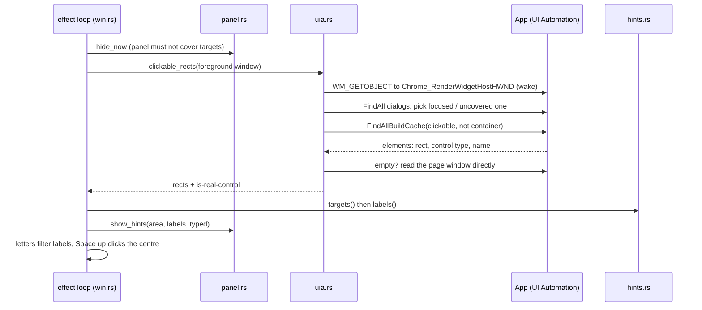

# Flow: hint labels

Entrypoint: `src/win.rs:333`

| # | Step | Where |
| - | ---- | ----- |
| 1 | Typing exactly a hint chord (`;`, `'`) opens labels; Caps repeat and Shift reopen them after a click | `src/win.rs:256`, `src/win.rs:278`, `src/config.rs:193` |
| 2 | The panel is hidden synchronously before the scan | `src/win.rs:333`, `src/panel.rs:162` |
| 3 | Up to 3 reads (0, 300, 600 ms) while Electron rebuilds its tree | `src/win.rs:158` |
| 4 | Chromium page windows get a wake-up `WM_GETOBJECT` | `src/uia.rs:219` |
| 5 | An open modal limits the scan: the focused one first, then one not covered at its centre | `src/uia.rs:143`, `src/uia.rs:245` |
| 6 | Elements whose centre is covered by another app's window are dropped | `src/uia.rs:121` |
| 7 | An empty read falls back to the page window (Electron after a minimize) | `src/uia.rs:178` |
| 8 | Parts of real controls and generic boxes around other clickables lose their label; cap 300 after filtering | `src/hints.rs:21` |
| 9 | Prefix-free labels from `sadfjklewcmpgh` | `src/hints.rs:40` |
| 10 | Labels drawn at each element's top-left on a click-through overlay | `src/panel.rs:574` |
| 11 | Space up with a full label moves the pointer to the element centre and clicks | `src/win.rs:347`, `src/win.rs:203` |

## Failure modes

| When | Result | Handled at |
| --- | --- | --- |
| UI Automation errors (e.g. `0x80040201` in Chrome) | `could not read this window's buttons`, after 3 tries | `src/win.rs:158` |
| Nothing clickable reported | `no clickable elements found`; Space up says `no labels on screen to pick from` | `src/win.rs:158`, `src/win.rs:310` |
| Element exists only as pixels (custom-drawn, Postman's ☰ and window buttons) | no label; nothing to read | — |
| A closed dialog lingers in the tree | ignored unless something in it is clickable | `src/uia.rs:143` |
