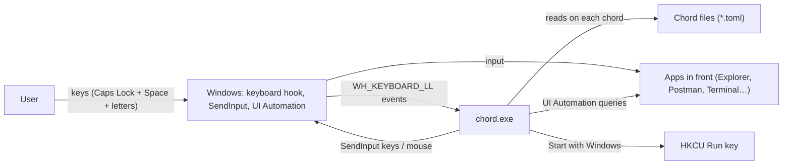
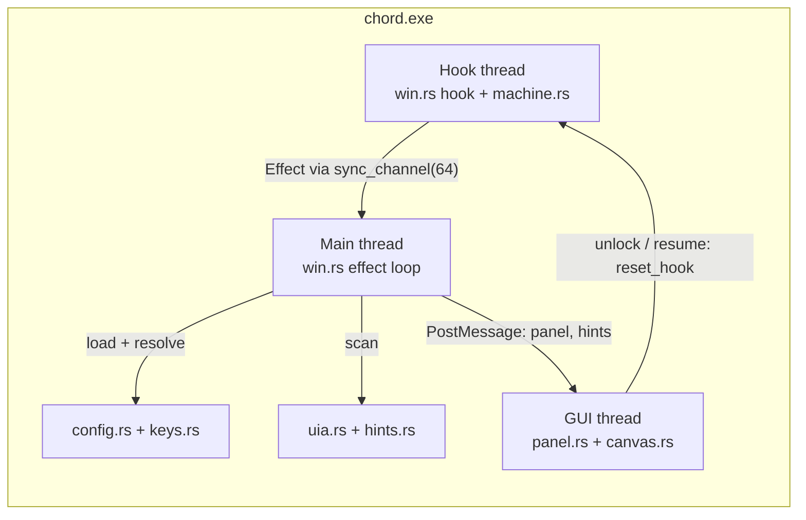

# Architecture

## Purpose and scope

chord turns short typed sequences into actions on Windows: key shortcuts, shell commands, app switching, mouse input, and clicks on labelled UI elements. It does not record macros, sync settings, or run scripts; chord files are the only configuration.

## Context

| External | Direction | Protocol | Why |
| --- | --- | --- | --- |
| Keyboard | in | `WH_KEYBOARD_LL` hook | detect Caps Lock + Space chords |
| Apps in front | out | `SendInput`, `SetForegroundWindow` | run shortcuts, mouse actions, focus |
| Apps in front | in/out | UI Automation (COM) | find clickable elements for labels |
| Chord files | in | TOML on disk | what each chord does |
| GitHub Releases API | in | HTTPS via `curl.exe`, only when the tray's "Check for updates" is clicked | find and download the newest installer (`src/update.rs`) |
| Registry `HKCU\Software\Microsoft\Windows\CurrentVersion\Run` | out | `RegSetKeyValueW` | Start with Windows |

## Containers

chord is one process. The boxes below are its threads and modules, not deployables.

| Container | Path | Run locally | Deployed to |
| --- | --- | --- | --- |
| `chord.exe` | `src/main.rs` | `cargo run --release` | GitHub Releases: installer and zip |

| Thread | Entry | Job |
| --- | --- | --- |
| Hook | `src/win.rs:609` | message loop for the keyboard hook; reinstalls it every 5 minutes |
| Main | `src/win.rs:278` | effect loop: panel updates, chord lookup, actions, label scans |
| GUI | `src/panel.rs:104` | panel and hint overlay windows, tray icon, unlock/resume events |

## Solution strategy

| Decision area | Choice | Evidence |
| --- | --- | --- |
| Language and UI | Rust, raw Win32 via the `windows` crate; no web view | `Cargo.toml` |
| Input capture | low-level keyboard hook; the callback only decides and hands off | `src/win.rs:630` |
| Key logic | pure state machine with timestamps, unit-tested off Windows | `src/machine.rs:129` |
| Configuration | TOML files re-read on every chord, no restart | `src/win.rs:508` |
| Clicking without a mouse | UI Automation scan + Vimium-style prefix-free labels | `src/uia.rs:56`, `src/hints.rs:92` |
| Drawing | layered windows with per-pixel alpha (antialiased corners, shadows, fades) | `src/canvas.rs:158` |
| Single instance | named mutex `Local\chord-ttncode-single-instance` | `src/win.rs:70` |

## Deployment

Pushing a tag `v<version>` that matches `Cargo.toml` runs `.github/workflows/release.yml` on a Windows runner: tests, an MSVC release build with the icon embedded (`build.rs`), the Inno Setup installer (`installer/chord.iss`), a portable zip, `SHA256SUMS.txt`, and a GitHub Release with the version's `CHANGELOG.md` section as notes.

| Artifact | Installs to | Chord files |
| --- | --- | --- |
| `chord-setup-<version>.exe` | `%LOCALAPPDATA%\Programs\chord`, per user; Start menu; optional HKCU Run entry | `%APPDATA%\chord\chords` |
| `chord-v<version>-windows-x64.zip` | wherever it is unzipped | its own `chords` folder |
